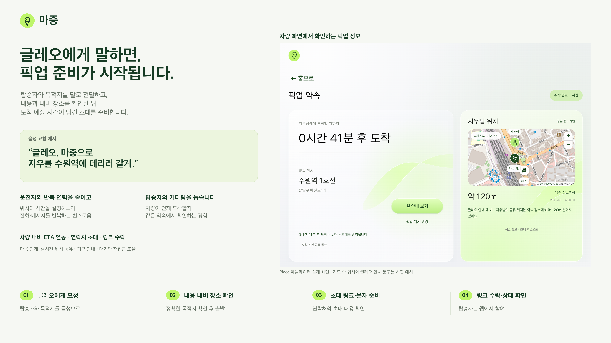

# 마중

**차량 화면에서 픽업을 준비하고, 도착 예상 시간과 탑승자 상태를 확인하는 Pleos 픽업 어시스턴트입니다.**

현대자동차그룹 차량용 앱 공모전을 위한 개인 프로젝트입니다. 공식 제출 APK는 **운전자 화면 시연용 데모**이며, 약속을 기기에 저장합니다. 별도 서버 실행·서버 주소 설정·탑승자용 기기 없이 운전자 화면을 확인할 수 있습니다.



[**시연 영상**](docs/demo.md) · [앱 화면 시안 이미지](docs/assets/majung-app-screens.png)

## APK 위치·Release 링크

- **공식 APK:** [apk/오하나_마중_release.apk](apk/오하나_마중_release.apk)
- **다운로드:** [공식 제출 Release — submission-demo-2026-11-15](https://github.com/hana5111/Majung/releases/tag/submission-demo-2026-11-15)
- **팀명·버전:** 오하나 · **0.2.2** (`versionCode 11`) · 제출 전용 키로 서명한 Release
- **파일 확인:** [SHA-256 체크섬](apk/SHA256SUMS.txt)

기존 제출 Release와 같은 키로 서명하여 업데이트할 수 있습니다. 다른 키로 서명한 Debug APK가 설치되어 있으면 새 AVD 사용을 권장합니다. 기존 앱을 삭제한 뒤 설치할 수도 있지만, 삭제하면 해당 앱의 로컬 데이터도 지워집니다.

## 실행 방법

### 설치 및 실행

아래 Pleos 에뮬레이터를 준비하고 **기어 P·정차 상태**에서 실행합니다. 저장소 루트에서 Android SDK의 `adb`를 사용할 수 있는 터미널로 다음 명령을 실행합니다. APK만 내려받았다면 설치 경로를 해당 파일 위치로 바꿉니다.

```sh
adb install -r "apk/오하나_마중_release.apk"
adb shell am start -n kr.ddakta.pickup/.MainActivity
```

앱 이름은 **마중**, 패키지는 `kr.ddakta.pickup`입니다. 공식 APK의 기본값은 로컬 데모 모드(`ddaktaDemoMode=true`)입니다.

### 빠른 운전자 화면 시연

1. 앱 상단의 **시연 약속 열기**를 누릅니다.
2. 수원역·지우 예시 약속에서 **초대 수락 시연**을 누릅니다.
3. 같은 운전자 화면에 표시되는 **가상 탑승자 지도·직선거리·접근 안내**를 확인합니다.
4. **시연 종료 · 초대 화면으로**를 눌러 돌아옵니다.

예시 약속은 기기에 저장되어 앱을 재시작해도 유지됩니다. 이 흐름은 외부 탑승자의 실제 수락이나 GPS 위치 공유를 수행하지 않습니다.

### 차량 내비와 도착 예상 시간 확인

1. **새 픽업 만들기**에서 탑승자 이름을 입력하고 **만날 장소**를 누릅니다.
2. 차량 내비에서 목적지를 선택한 뒤 마중으로 돌아와 **이 장소로 지정**을 누릅니다.
3. **픽업 저장하고 길 안내**를 누르고 약속 상세 화면에서 도착 정보를 확인합니다.

도착 예상 시간은 **저장된 픽업 위치와 일치하는 실제 NaviHelper 안내 경로가 확인될 때만** 표시합니다. 가상 탑승자 위치 시연과 실제 내비 도착 시간은 별개입니다.

## Pleos Connect 에뮬레이터 버전·화면 규격

| 항목 | 확인 환경 |
| --- | --- |
| Pleos 에뮬레이터 버전 | **Pleos Connect v2.1.0** |
| 사용한 AVD 표시 이름 | `Pleos Connect v2.1.0 (2)` — `(2)`는 AVD 이름의 번호 |
| 운영체제 | Android 14 · API 34 |
| 화면 해상도 | **2560 × 1440px**, 가로 **16:9** |
| 화면 밀도 | **160dpi** (`wm size` / `wm density` 실측) |

입력·장소 확인은 정차 중 이용합니다. 일반 스마트폰에서는 Pleos 차량 내비 연동을 확인할 수 없습니다.

## 테스트 환경 및 필요한 설정

| 항목 | 구성·설정 |
| --- | --- |
| 공식 APK 실행 | 위 Pleos 차량 내비 환경. 별도 약속 서버 설정 불필요 |
| 인터넷 | 차량 내비의 장소 검색과 지도 타일 표시에 필요 |
| 내비 SDK | Pleos NaviHelper **3.0.5** |
| 소스 빌드용 Java | Gradle daemon **JDK 25** (`gradle-daemon-jvm.properties`) |
| Android SDK | **compile 37 · target 34 · min 28** |
| 빌드 도구 | **Gradle 9.6.0 · AGP 9.5.1 · Kotlin 2.2.10** |
| Gleo 음성 기능 | 선택 사항. Gleo(`ai.umos.ambientai`) 설치 및 마중의 `assets/schema.json` 기능 등록 필요 |

이름 직접 입력과 내비 장소 선택은 Gleo 없이 확인할 수 있습니다. Gleo Action 요청·승인·콜백 연동 코드는 포함하지만, 실제 음성 왕복은 별도 확인이 필요합니다.

### 소스에서 직접 빌드

Android Studio에서 `pickup-android`를 열고 JDK 25와 Android SDK 37을 설정합니다. SDK 경로는 Android Studio 또는 로컬 `local.properties`에서 지정합니다.

```sh
cd pickup-android
./gradlew :app:assembleDebug :app:assembleRelease
```

Windows에서는 `./gradlew` 대신 `gradlew.bat`을 사용합니다. 별도 속성 없이 빌드하면 공식 APK와 같은 로컬 데모 모드입니다.

- Debug: `app/build/outputs/apk/debug/app-debug.apk`
- **서명 전 Release:** `app/build/outputs/apk/release/app-release-unsigned.apk`

서명키는 저장소에 포함하지 않습니다. 직접 빌드한 Release를 설치하려면 Android Studio의 **Generate Signed Bundle / APK** 등으로 본인 키를 사용해 서명해야 합니다.

### 개발 옵션: API·탑승자 웹 연동

공식 심사 시연에는 필요하지 않습니다. `pickup-server`와 `pickup-web`은 기존 API·초대 웹을 테스트하는 개발 옵션이며, 두 폴더의 상대 위치를 유지합니다. Node.js 22.12 이상에서 `pickup-server`의 `npm start`로 로컬 서버를 실행한 뒤, `pickup-android`에서 다음과 같이 빌드합니다.

```sh
./gradlew :app:assembleDebug \
  -PddaktaDemoMode=false \
  -PddaktaApiUrl=http://10.0.2.2:8787 \
  -PddaktaInviteOrigin=http://127.0.0.1:8787
```

속성은 빌드 시 결정됩니다. 이 초대 주소는 같은 PC 브라우저의 개발 테스트용이며, 다른 기기에서 사용할 외부 API·초대 웹은 HTTPS 주소로 별도 구성합니다. Gleo 대상 패키지는 `ddaktaGleoPackage`로 지정하며 기본값은 `ai.umos.ambientai`입니다.

## 구현·시연 범위

- 기기 안의 약속 생성·저장·취소, 차량 내비 목적지 선택·경로 요청, 실제 경로의 도착 시간 표시를 구현했습니다.
- **초대 수락·탑승자 위치·직선거리·접근 안내는 운전자 화면의 가상 시연**입니다.
- 실제 SMS 송수신·외부 탑승자 수락·휴대폰 GPS 공유는 공식 데모에 포함하지 않습니다. GPS 공유·정차 가능 구역 추천·자동 정차는 미구현입니다.
- 차량 제어와 자동 문자 발송은 수행하지 않습니다.

실제 차량 앱 소스는 **`pickup-android`**, `pickup-prototype`은 **초기 웹 시안**입니다.

## 검증 결과

2026-11-15 운전자 화면 시연용 0.2.2 기준:

- Android 단위 테스트 **67개 통과**. 로컬 저장·재오픈·동시성·저장 실패 검사 **10개** 포함.
- Release APK 빌드·제출 전용 키 서명 완료. 기존 제출 Release와 같은 인증서이며 디버깅은 비활성화했습니다.
- `lintRelease`: **오류 0개 · 경고 25개**.
- 별도 Pleos 에뮬레이터에서 **네트워크를 끈 상태로 예시 약속 저장·초대 수락 시연·가상 위치 표시**를 확인했습니다.
- 앱을 강제 종료하고 다시 실행해도 기기에 저장한 약속이 유지되는 것을 확인했습니다.

```sh
cd pickup-android
./gradlew :app:testDebugUnitTest :app:lintRelease
```

실제 문자 발송·휴대폰 GPS 공유·전체 음성 왕복·실차 주행은 검증 범위에 포함하지 않았습니다.

## 외부 리소스

가상 위치 시연 지도는 [Leaflet](https://leafletjs.com/)과 [OpenStreetMap](https://www.openstreetmap.org/copyright)을 사용합니다. Leaflet 라이선스는 [vendor/LICENSE](pickup-android/app/src/main/assets/passenger-map/vendor/LICENSE)에 포함했습니다.
