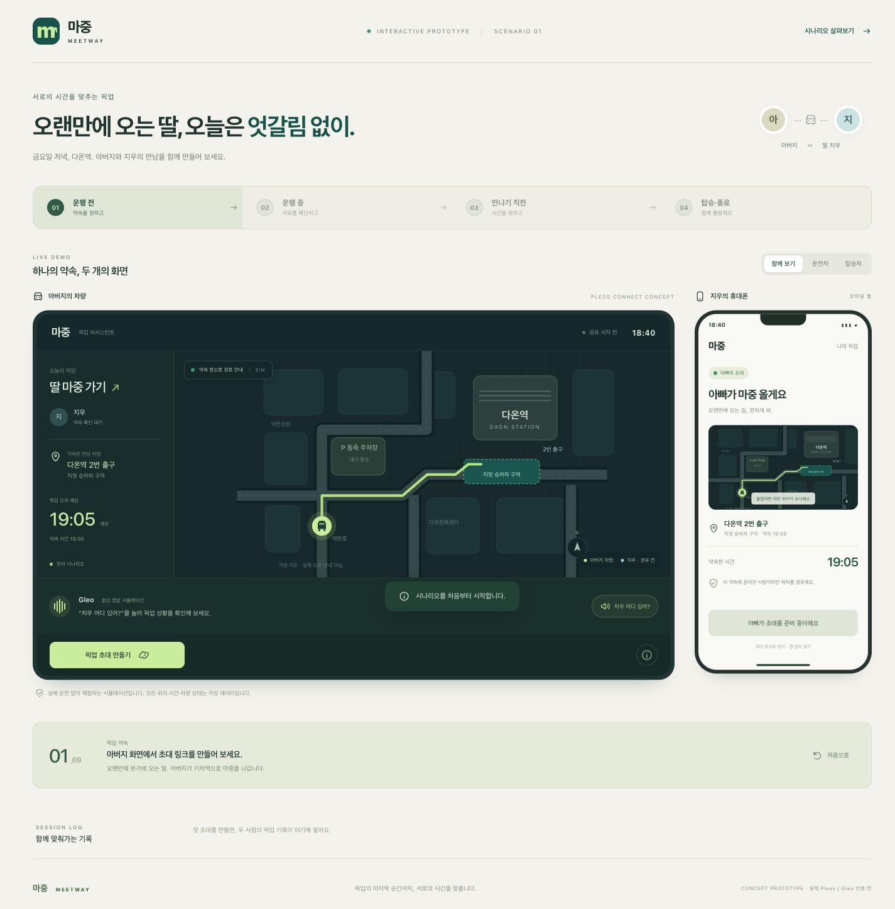

# 웹 프로토타입

## 구현된 범위

- 반응형 차량 화면·휴대폰 화면 동시 보기 / 단독 보기
- 초대 문구 모달·복사 및 데모 약속 수락
- 가상 경로·차량 위치·준비 상태·ETA 표시
- 준비 지연 → 주차장 대기 → 준비 완료 → 재접근
- 현재 상태에 따른 Gleo 텍스트 응답 시뮬레이션
- 운전자 정차 확인 후 탑승 완료 허용
- 탑승 후 공유 종료·세션 기록·초기화

## 검증

- TypeScript 검사와 Vite 배포 빌드
- 상태 전이 테스트: 잘못된 순서 방지, 정차 전 완료 방지, 공유 종료, 초기화
- 브라우저에서 초대부터 완료까지 전체 흐름 확인
- 1440px 및 390px 너비에서 가로 넘침 확인

## 아직 연결하지 않은 기능

- 실제 초대 URL 발급·서버·로그인·별도 기기 동기화
- 실제 GPS·지도·보행/차량 경로 계산·주차 정보
- 실제 음성 인식·Gleo·Pleos SDK·차량 제어
- 자동 시간 계산·안전한 정차 장소 판정

단일 브라우저의 React 상태가 두 화면을 연결합니다. 새로고침하면 초기화됩니다.
UI의 가상 링크 주소는 예시이며 실제 공유 링크가 아닙니다.

## 화면 미리보기

